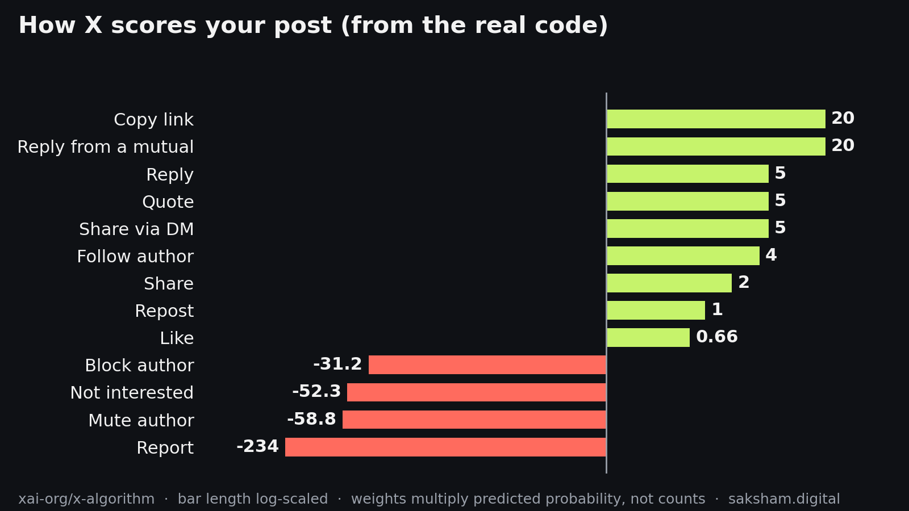
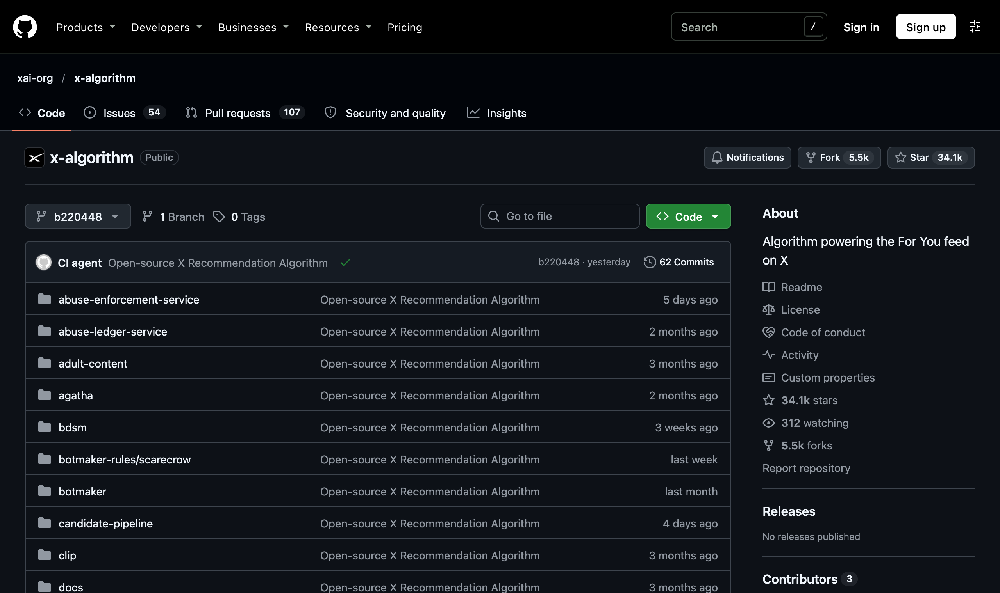
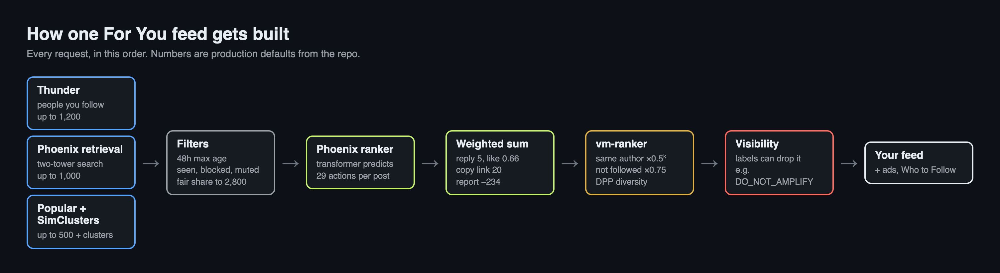
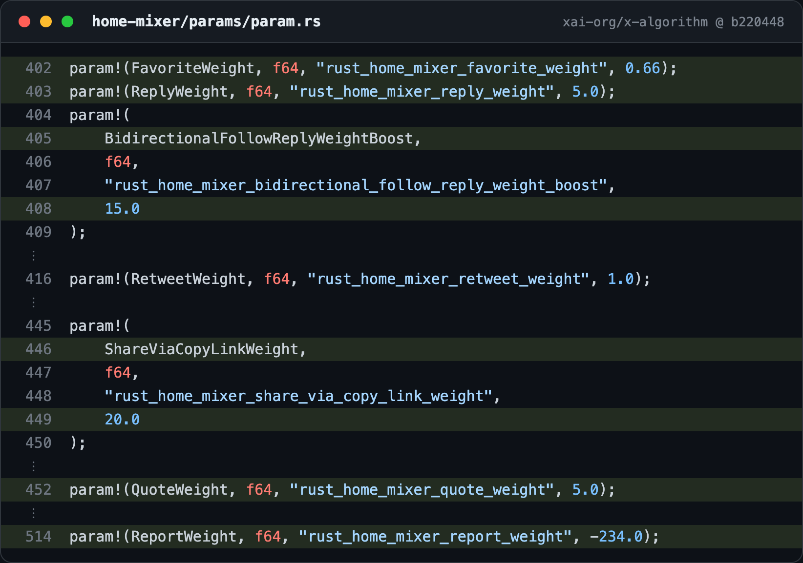
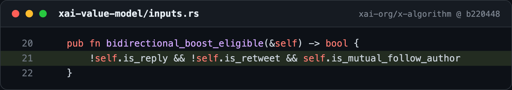
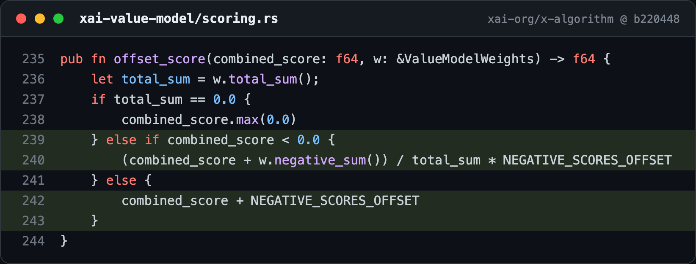
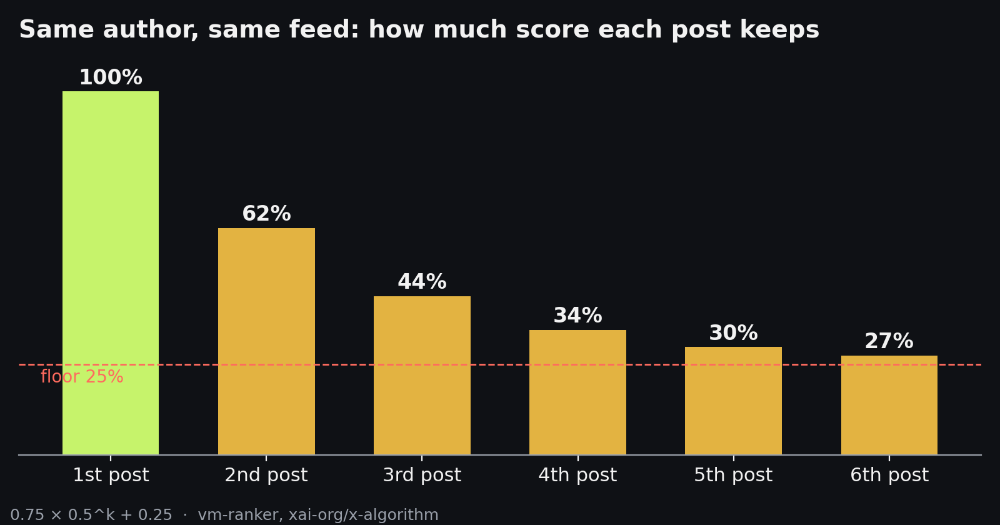
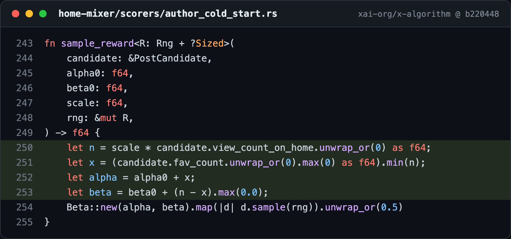
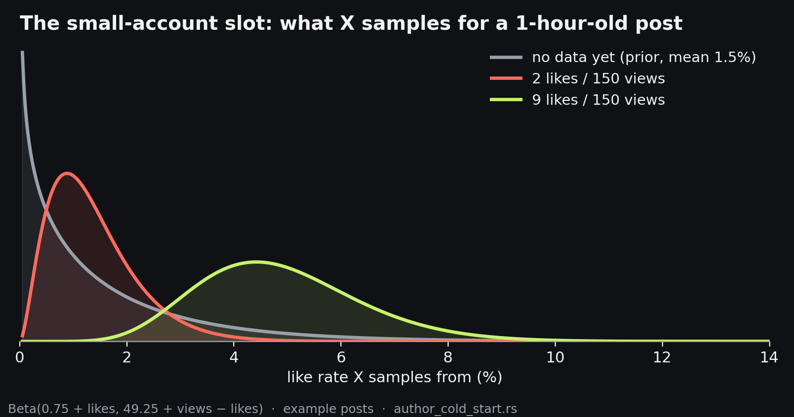
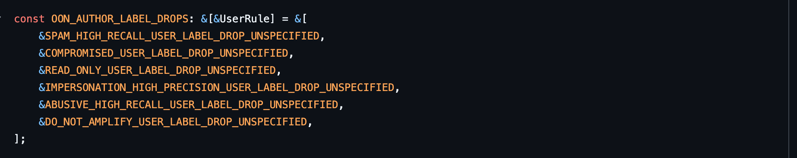

xAI open-sourced the code behind X's For You feed. Most of what I saw online about it came from the README or from people quoting each other, so I cloned the repo and read the code itself: the Rust that builds your feed, the JAX that trains the model, and the config file X syncs from production.

This is what I found, read at commit `b220448` from 3 November 2026. Every number below is from the code, with the file it lives in.


*The repo. 2,352 files of Rust, JAX and Scala, with a commit almost every weekday.*

Before the numbers, here's the whole path a feed takes. Every time you open For You, this runs from left to right:


*One feed request, start to finish. Most of this post is about the green and amber boxes.*

## How a post gets scored

Every post you could see gets one score:

```
score = sum of (weight × the chance you'll take that action)
```

The model predicts the chance you'll like, reply, repost, share, mute, report and about 20 other actions. Each prediction is multiplied by a weight, and the results are added up. The weights live in `home-mixer/params/param.rs`, and X runs a cron job that copies the production values into that file. The last sync before I read it was 2 November.

| Action | Weight |
|---|---|
| Copy link to post | **20** |
| Reply | **5** |
| Quote | **5** |
| Share via DM | **5** |
| Follow the author | 4 |
| Share | 2 |
| Repost | 1 |
| Like | **0.66** |
| Click | 0.3 |
| Open a link | 0.2 |
| Profile click | 0 |
| Video quality view | 0 |
| Block author | -31.2 |
| Not interested | -52.27 |
| Mute author | -58.8 |
| Report | **-234** |


*The actual lines, from the file X syncs from production.*

One thing to get right before reading too much into this table. The weights multiply your *predicted chance* of doing something, not counts. Reports are more than 1,000 times rarer than likes, so a report needs a huge weight just to move the ranking at all. "One report cancels 354 likes" is the wrong reading. X even added a code comment warning against exactly this math (their example says 468 likes).

The right reading: X values conversation and sharing far more than approval. A reply is worth about 7.6 likes. A copied link is worth about 30.

## The biggest lever: mutuals

There is one extra parameter, `bidirectional_follow_reply_weight_boost = 15`. If the post is an original post (not a reply or a repost) and the author follows you back, the reply weight goes from 5 to 20.

So **one reply from a mutual is worth about 30 likes.**


*The whole eligibility rule is one line: original post, and you follow each other.*

X documented the rollout in `docs/BIDIRECTIONAL_BOOST_CHANGE.md`. They A/B tested boosts of 5, 10, 15 and 20 starting 10 July 2026, shipped 20 on 13 July, then cut it to 15 on 24 July after people complained they were missing World Cup posts from accounts they didn't follow.

## One negative prediction sinks a post

This is easy to miss. In `xai-value-model/scoring.rs`, a post with a positive total gets a small constant added. A post with a negative total gets squashed into a tiny range below that constant.


*Positive totals get `+ 0.001`. Negative totals get squeezed in below 0.001.*

So **every post with a negative total ranks below every post with a positive total**, no matter how close to zero it is. If the model thinks a viewer is likely to mute you or hit "not interested", your post is effectively gone from their feed.

## What happens after scoring

These adjustments don't run where the README says. Home-mixer hard-codes them off, and the separate `vm-ranker` service applies them:

- **Same-author decay.** Your k-th post in one feed load is multiplied by `0.75 × 0.5^k + 0.25`. Your 1st post keeps 100%, the 2nd 62.5%, the 3rd 44%, and it never drops below 25%.
- **Out-of-network discount.** Posts from accounts the viewer doesn't follow get ×0.75. So do replies and reposts from accounts they do follow.
- **Diversity rerank.** Out of the top 150, a determinantal point process (θ = 0.65) trades a little score for posts that look less alike, using cosine similarity of post embeddings. Ten near-identical takes on the same news story won't all make it.


*Posting a burst doesn't multiply your reach. Each extra post in one feed keeps less of its score.*

There is no time decay in the score. Freshness comes from a hard 48-hour cutoff and from post age being one of the model's inputs.

## Small accounts get a free shot

`home-mixer/scorers/author_cold_start.rs` is a real bandit. On each feed request, at most one post gets lifted to slot 16 if all of these are true:

- it's an original post, not a reply or a repost
- the author has **50,000 followers or fewer**
- the post is **under 2 hours old**
- it has **fewer than 200 home-feed views**

To pick which one, X uses Thompson sampling. For each candidate it draws a like rate from `Beta(0.75 + likes, 49.25 + views − likes)`, which starts at a 1.5% prior. It keeps the top 2 draws and takes whichever the model scores higher.


*The bandit, in 13 lines.*

Here's what that looks like for two example posts with the same 150 views:


*The post with 9 likes almost always draws a higher number, so it almost always wins the slot. The post with no data yet still has a long tail, which is how new posts get a chance.*

In plain words: **your likes per view in the first 2 hours decide whether X tests you on new people.**

## The model, Phoenix

If you work on recommender systems, this part is worth reading on its own. It's the most complete production recommender I've seen released.

- **Ranking:** a transformer with 8 layers, width 2560, and 20 query heads sharing 4 key/value heads. It reads your last 1,022 actions plus 64 candidate posts.
- **Candidate isolation:** candidate posts can attend to your history but not to each other. A post's score doesn't depend on what else is in the batch, so it can be cached.
- **Hash embeddings:** users, posts and authors are hashed into tables of 100M, 100M and 30M rows, two hashes each, so there's no vocabulary to maintain and a brand-new post works instantly.
- **Semantic IDs:** each post's multimodal embedding is quantized into 6 levels of 256 codes. Posts on the same topic share code prefixes, which helps the model generalise to posts it has never seen.
- **About you:** country, language, location, inferred gender, age bracket, and a 10-million-row table of IP address hashes. An installed-apps feature exists but is switched off in the ranker.
- **Training:** 1e11 examples, the Muon optimizer for dense weights, row-wise AdaGrad for the embedding tables.
- **8 October change:** time-spent prediction moved from a Tweedie + MAE loss to CREAD, which classifies dwell time against 30 log-spaced thresholds from 2 to 120 seconds and then restores a number. That's what the changelog means by "predicts time spent much better".

Retrieval, the step that finds posts from people you don't follow, is a two-tower model. A transformer encodes your history into one vector, and the top matches come from an index of about 10 million posts.

## What can hide a post regardless of score

After ranking, `visibility-filtering` checks every post. Some rules drop a post for everyone: suspended authors, spam labels, legal takedowns, and "Freedom of Speech, Not Reach" labels for hateful conduct, violent speech, abuse and civic integrity.

A second set only applies when the post would reach someone who doesn't follow the author. These include account labels like `SPAM_HIGH_RECALL`, `IMPERSONATION_HIGH_PRECISION`, `ABUSIVE_HIGH_RECALL` and **`DO_NOT_AMPLIFY`**. Followers still see the post. Strangers never do.


*The list of account labels that block recommendations to non-followers. `DO_NOT_AMPLIFY` is the last one.*

That's the "not banned, just not recommended" mechanism, written down in `visibility-filtering/rules/levels.rs`. The labels come from LLM classifiers running on Grok 4.1 Fast (the prompts aren't published), image and video models, and offline account-scoring jobs. X's [Under the Hood](https://x.com/i/jf/under_the_hood) page shows which labels are on your own account.

## What the code settles

- **Premium gets no boost in ranking.** There's no Premium weight or multiplier anywhere in the scoring code, and the feed service only logs subscription level. One caveat: the author's tier is part of the account text X feeds into each post's embedding, so the model can see it.
- **Strangers mass-reporting you does little.** Only actions on posts X actually served in the feed count, and predictions are personalised, so reports mostly affect people who behave like the reporters.
- **Links aren't penalised by a weight.** Opening a link is +0.2. Link posts lose because people reply to them less.

## Where the README and the code disagree

- The README links `visibility-filtering/rules/registry.rs`, but that file doesn't exist. The rules are in `tweet_rules.rs`, `author_rules.rs` and `levels.rs`.
- The README says the ranking scorer applies the author-diversity and out-of-network adjustments. In the code they're switched off there and applied in vm-ranker.
- `FairShareRankingFilter` is enabled in production but missing from the README's filter list. It trims candidates to 2,800, split proportionally across sources.
- The `Brazil2026ElectionFilter` was removed on 26 October, but a visibility rule that drops election-labelled posts for viewers in Brazil is still in the code.

## So how do you get reach?

1. **Write things people reply to or send to a friend.** A reply is 5, a copied link 20, a like 0.66.
2. **Build mutuals in your niche.** Their replies count four times as much.
3. **Post when your audience is online.** The first 2 hours decide the small-account slot.
4. **Post once, not three times in a row.** The 3rd post keeps 44%.
5. **Don't bait strangers.** A predicted mute or "not interested" puts you below every positive post.
6. **Check Under the Hood** before blaming the algorithm.

None of this is a cheat code. The weights are fixed, but the predictions come from a model trained on what people really did. The only way to raise "chance this person replies" is to write something they want to reply to.

The repo is at [github.com/xai-org/x-algorithm](https://github.com/xai-org/x-algorithm). The small model configs train on one NVIDIA GPU if you want to run Phoenix yourself.
