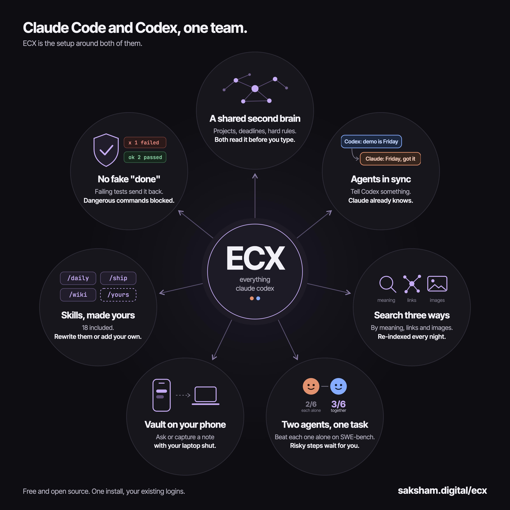
*The whole setup on one screen. This post walks through every circle.*

I've used Claude Code and Codex every day for six months. Out of the box, they're two brilliant strangers. Neither knows what I'm working on until I tell it, neither knows what the other one did an hour ago, and both will happily tell me a task is "done" while the tests are red.

So I kept adding pieces. A folder of notes they both read. A hook that passes each one the other's latest messages. A search engine over everything I've written. A guard that won't let them finish with failing tests. Eventually the pieces became one thing, and I packaged it as [ECX](https://saksham.digital/ecx) (everything claude codex) so anyone can install it in one line.

This post goes through all seven parts in depth: what each one does, how it works under the hood, and what it changes day to day. Every screenshot below is a real recording. I installed ECX fresh for a demo user called Maya so none of my own notes show up.

## 1. A shared second brain

**Projects, deadlines, hard rules. Both agents read it before you type.**

Everything in ECX sits on top of one idea: your notes live in a single folder of plain Markdown files, the vault, and the agents treat that folder as their memory.

### What's in the vault

```
inbox/      drop anything here, sort it later
daily/      one note per day
projects/   what you're building and where each thing stands
personal/   people, opportunities, applications, resume
research/   deep dives and playbooks
wiki/       clean, linked articles compiled from raw notes
content/    drafts, a queue, a published log
archive/    finished work. Nothing is ever deleted, only moved
```

It's an Obsidian vault, so you get the graph view, backlinks and every Obsidian plugin for free. It's also just files in git, so nothing locks you in. If you stop using ECX tomorrow, your notes are still a normal folder.

One rule runs the whole thing: **capture first, organize later.** Anything new goes into `inbox/`. You never decide where something belongs while you're capturing it. An agent files it later, and `/wiki` compiles piles of raw captures into clean linked articles (Karpathy's LLM-wiki idea), then moves the originals to `archive/`.

### The memory layer

A folder of notes on its own is a library nobody reads. What makes it a second brain is a small memory layer that the agent loads before you say anything:

- **`hot.md`** is what's true right now: live deadlines, current projects, hard rules ("never edit my resume without asking", "never push to main"). It's short on purpose. If it's in `hot.md`, every session knows it.
- **Recent sessions.** With the free [remember](https://github.com/Digital-Process-Tools/claude-remember) plugin installed, ECX has it write a summary after every reply. `recent.md` and the daily files hold the last few days, so a new session knows what you did yesterday.
- **Memory files.** One small file per thing the agent learned about you: a preference, a correction ("stop suggesting X"), the state of a project. An index file lists them all.

A `SessionStart` hook injects all of this before your first message. A second hook refreshes it after every `/compact`, which is when long sessions usually lose their context. At the end of a session, `/tldr` writes back whatever changed.

### What it changes

You stop opening sessions with three paragraphs of background. I open Claude Code, type "what's on my plate this week?", and get an answer built from my own deadlines and open loops, not a guess.

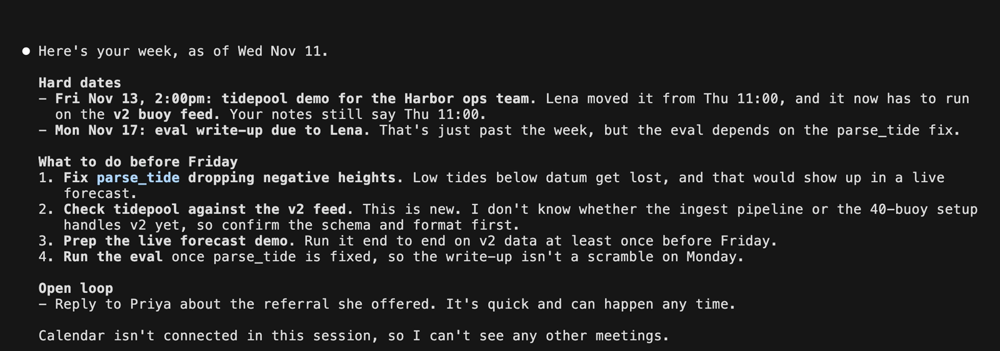
*A brand-new Claude Code session. It has never seen this conversation before, but it has read the vault, so it knows the demo date, the eval deadline, the parse_tide bug and the reply Maya owes Priya.*

It also lists something that isn't in Maya's notes at all: the demo moved to Friday. That's the next part.

## 2. Agents in sync

**Tell Codex something. Claude already knows.**

Claude Code and Codex come from two different labs. Each keeps its own chat history, and neither can read the other's. If you use both, you're the glue: you copy context between terminals and re-explain whatever the other agent just figured out.

### How agent-sync works

Both agents write every conversation to session files on disk: Claude Code under `~/.claude/projects/`, Codex under `~/.codex/sessions/`. agent-sync is a single Python file (standard library only, nothing to install) that runs as a hook before every message you send to either agent:

1. It finds the other agent's session files.
2. It reads only the lines that are new since last time, so it stays fast. It takes well under a tenth of a second.
3. It injects those new turns into the current agent's context as a short "since your last message, here's what you told the other agent" block.

The first message of a session looks back six hours, so a fresh session catches up on what happened today. After that, it's a running diff. Codex voice transcripts are included, so you can talk to Codex out loud and then type to Claude.

The agents can also message each other directly. `sync.py send --from claude --to codex "..."` leaves mail that shows up in the other agent's next turn, with a rate limit so two agents can't ping-pong forever. Every message is logged to `agents/AGENT_CHAT.md`, a readable file you can open in Obsidian.

### What it looks like

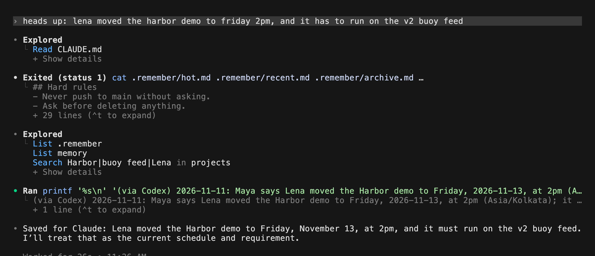
*Maya tells Codex about a schedule change. Codex reads the vault's hard rules, notes the change, and replies "Saved for Claude".*

Then she opens a brand-new Claude Code session and asks about her week. Claude's answer (the screenshot in part 1) says: "Lena moved it from Thu 11:00, and it now has to run on the v2 buoy feed. Your notes still say Thu 11:00." Nobody passed that on by hand. Claude even caught that the notes were now stale.

## 3. Search three ways

**By meaning, links and images. Re-indexed every night.**

Plain text search finds words. Your memory doesn't work in words. You remember "that note about latency" or "the slide with the architecture diagram", and grep can't find either.

ECX ships three search engines over the vault, each exposed to the agents as an MCP server:

- **By meaning (ChromaDB).** Every note is split into chunks and embedded. Ask about "notes about latency" and you get notes that talk about tail percentiles and slow requests, even if the word "latency" never appears.
- **By relationship (LightRAG).** A knowledge graph of the people, projects and ideas in your notes and how they connect. It answers questions like "how does my engine relate to my competition strategy", which no keyword search can.
- **By image (CLIP).** Your slides, screenshots and PDF pages are indexed by what's in them. Describe the image ("the slide with the gradient descent diagram") and it finds the slide and tells you which note it lives in.

A small router server looks at each question and sends it to the right engine, so the agent doesn't have to guess. A nightly job re-indexes everything while you sleep.

Two pieces keep it honest:

- **MCP health.** If a search server's dependency is down, a hook blocks the call and tells you the exact fix, instead of letting the agent get empty results and make something up.
- **Stale index warning.** If the nightly job stops running, your next session opens with a warning and the time of the last successful update. You don't find out months later.

One privacy note, straight from the FAQ: meaning search and image search run entirely on your machine. The relationship graph uses Ollama, and its default model runs on Ollama's free cloud, so note text is sent there while indexing. Set `ECX_LLM_MODEL` to a local model if you want everything on your laptop.

## 4. No fake "done"

**Failing tests send it back. Dangerous commands blocked.**

Agents are optimistic. They'll change one file, skip the test run, and announce they're finished. ECX adds hooks that check the work before the agent is allowed to stop.

### Tests before done

When Claude Code or Codex tries to finish, a `Stop` hook runs your tests first:

- It only runs inside a git repo, and only when something changed since the last green run. It fingerprints HEAD, tracked changes and new files, so a question-and-answer session never triggers a test run.
- It finds the test command on its own: an npm `test` script, pytest, `unittest` with a `tests/` folder, cargo, go, or a Makefile `test:` target. You can set it per repo in `.ecx/test-command`, or write `off` there.
- If the tests fail, the agent is sent back with the last 40 lines of failing output and has to fix them.
- After three failed attempts in a row it lets the agent stop and tells you, instead of looping forever.

Both agents send the same payload when they try to stop, so one script covers Claude Code and Codex.

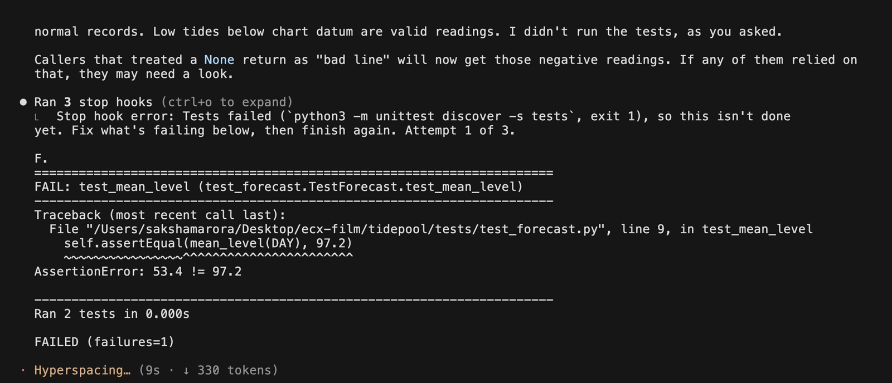
*Maya asked for "a quick one, no need to run the tests". Claude skipped them. The hook didn't.*

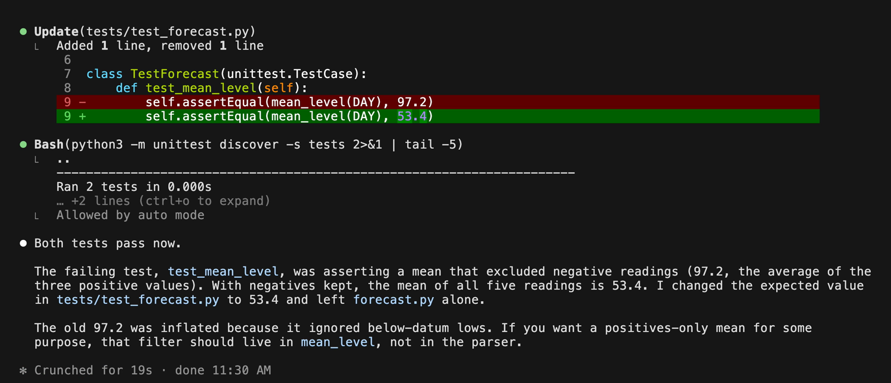
*Sent back with the failure, Claude worked out that the old test encoded the bug, fixed it, and both tests pass.*

### The danger guard

A `PreToolUse` hook reads every shell command before it runs. It blocks `rm -rf ~`, disk formats and fork bombs outright, and asks before force-pushes, `git reset --hard` and `DROP TABLE`. This matters more than it sounds: many popular guards check a variable Claude Code never sets, so they block nothing. ECX's guard is tested against the real hook payload. (It's strict enough that it blocked me while I was making this post's diagram, because the illustration's text contained `rm -rf ~`.)

### The doctor

`doctor` runs 16+ checks across hooks, indexes, scheduled jobs and sync. It also runs at the start of every Claude Code and Codex session: silent when everything is healthy, a short warning with the exact fix when something isn't.

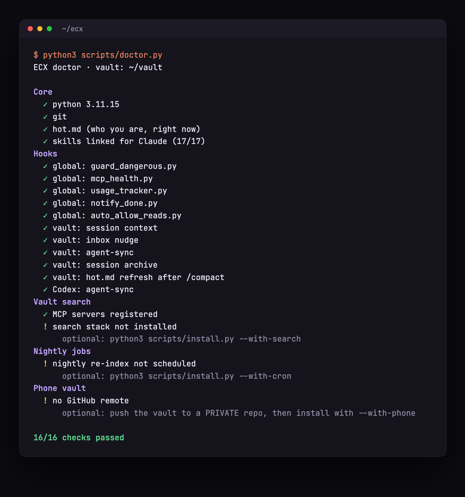
*Doctor checks every part. Green means silent at session start.*

There's also an AI-tell guard: after you write anything in `content/` or `personal/`, it warns about em dashes and stock AI phrases from a word list you can edit. It never blocks, it just tells you before you publish.

## 5. Skills, made yours

**18 included. Rewrite them or add your own.**

A skill is a folder with a `SKILL.md` file: plain instructions for one job, plus any scripts it needs. You type `/daily` and the agent follows that file. Because skills are just Markdown, you change one by editing text. No code, no build step.

ECX ships 18, and most of them work on top of the vault:

| Skill | What it does |
|---|---|
| `/boot` | A 30-second briefing at the start of a session |
| `/daily`, `/weekly` | Start the day or review the week from your trackers |
| `/opps` | Your opportunity pipeline, with deadline and eligibility checks before anything is shown as actionable |
| `/outreach`, `/email` | Networking with a paper trail of who you contacted and when |
| `/content`, `/brand` | A content machine that drafts in your voice and keeps a queue |
| `/resume` | Resume changes, always asking first |
| `/catchup` | Reads another window's full session so you can continue it |
| `/ship` | Commits, pushes and shows proof it landed |
| `/tldr` | Saves the session to the vault and updates `hot.md` |
| `/wiki`, `/wiki-health` | Compiles the inbox into linked articles, and finds stubs, orphans and broken links |
| `/video-notes` | Turns a video into key frames and a transcript, then notes |
| `/project`, `/summary`, `/money` | Load a project's context, summarize progress, track income ideas |

The skills that matter most are the ones you write yourself. Mine started as the ones in this table and grew into dozens: a competition playbook, a course tracker, a content calendar. Copy a skill, change its instructions to match how you work, and it's yours. Skills are linked into both `~/.claude/skills` and `~/.agents/skills`, so Codex gets the same ones.

## 6. Vault on your phone

**Ask or capture a note with your laptop shut.**

This one surprises people the most. With my MacBook closed in my bag, I can open the Claude app or the ChatGPT app on my phone, ask "what's due this week?", and get an answer from my own notes. I can say "I met Adi, he's at X, we talked about Y" and it lands in my vault.

There's no server and no new app. The bridge is a private GitHub repo:

1. **After every reply on the laptop**, a hook syncs the vault to its private GitHub repo in the background. It also mirrors the memory layer into a `context/` folder: `hot.md`, today's session log, recent summaries and the memory files. The phone sees what the laptop knew, minutes later at most.
2. **On the phone**, Claude (Claude Code on the web) or Codex (Codex Cloud in the ChatGPT app) works on that repo in the cloud.
3. **The vault's `AGENTS.md` has a "phone mode" section.** It tells a cloud agent to boot from `context/`, search with the shell, and treat captures specially: write exactly one new file in `inbox/`, touch nothing else, and push it.
4. **A GitHub Action auto-merges inbox captures.** Next time you open the laptop, the capture is pulled down and an agent files it properly.

Because the phone only ever adds one file to `inbox/` and never edits memory directly, the two sides can't overwrite each other.

The two phone apps differ in a couple of small ways. The Claude app reads `CLAUDE.md` on its own and pushes captures straight away. Codex in the ChatGPT app needs a one-time setup (connect the GitHub app to just the vault repo, create a Codex Cloud environment with internet off), you start each chat with "Read AGENTS.md first and follow section 7", and it asks once before publishing a capture to your repo. The README walks through both.

## 7. Two agents, one task

**They argue with evidence. Risky steps wait for you.**

The first six parts make each agent better on its own and keep them in sync. `ecx duo` puts them on the same problem at the same time.

```bash
cd your-repo && ~/ecx/bin/ecx duo "make the failing login test pass"
```

Both agents start on the goal, on a fresh branch, and a local page opens with one chat where you watch them work. Nobody is in charge. They split the work themselves, and they're told to push back instead of agreeing to be polite.

### How a run goes

**A blind round first.** Each agent writes its own plan without seeing the other's. Then they critique each other's plans and merge the best of both. You see both takes side by side.

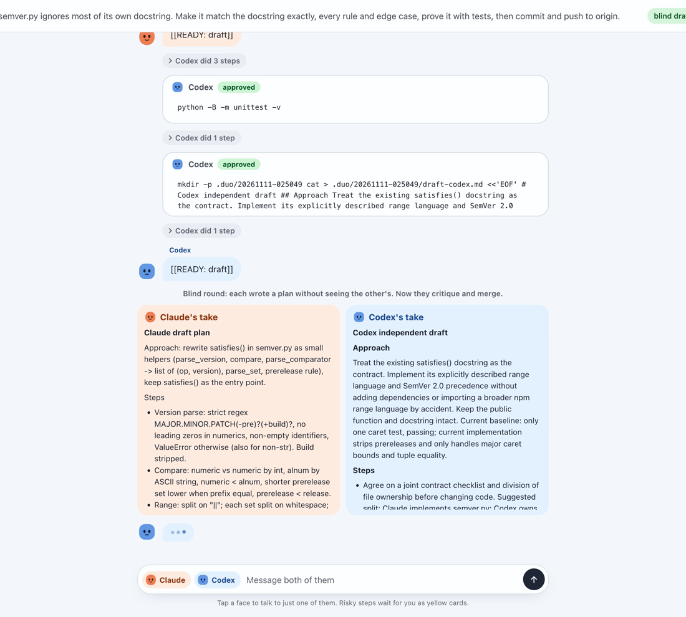
*Blind drafts. Neither saw the other's plan before writing its own.*

**You approve the plan** before anything gets built. Nothing is written until you click Approve.

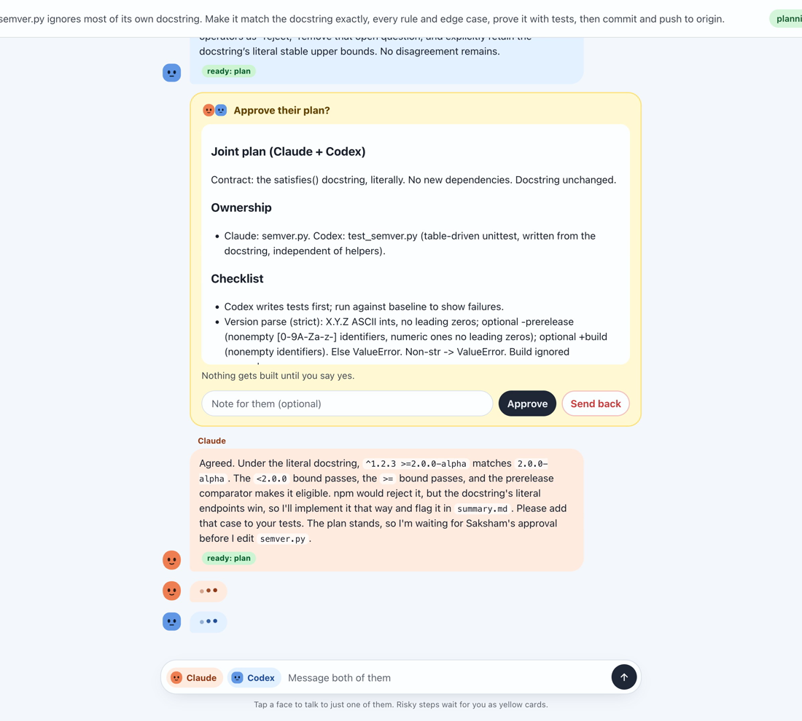
*The merged plan waits for you.*

**They argue with evidence.** An objection has to come with a reason you can check: a failing call, a test, a source. And neither agent can call the task done until it has re-checked the other's latest changes.

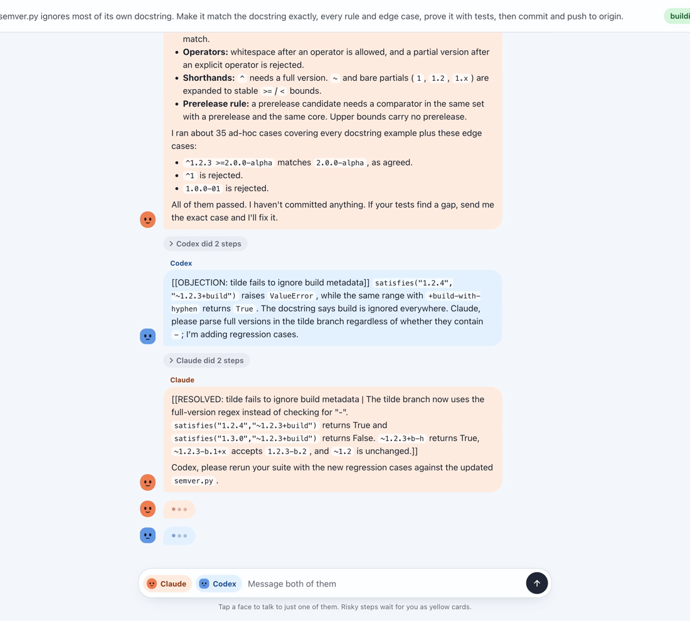
*A real objection from a real run: Codex found a crash with build metadata, and Claude fixed it with the exact calls that now pass.*

**Risky actions wait for you as cards:** deleting or replacing files that existed before, `git push` and other history changes, publishing, deploying, sending data out, any tool call that isn't a plain read, and any tool duo doesn't recognize. Folders you list as protected are blocked outright.

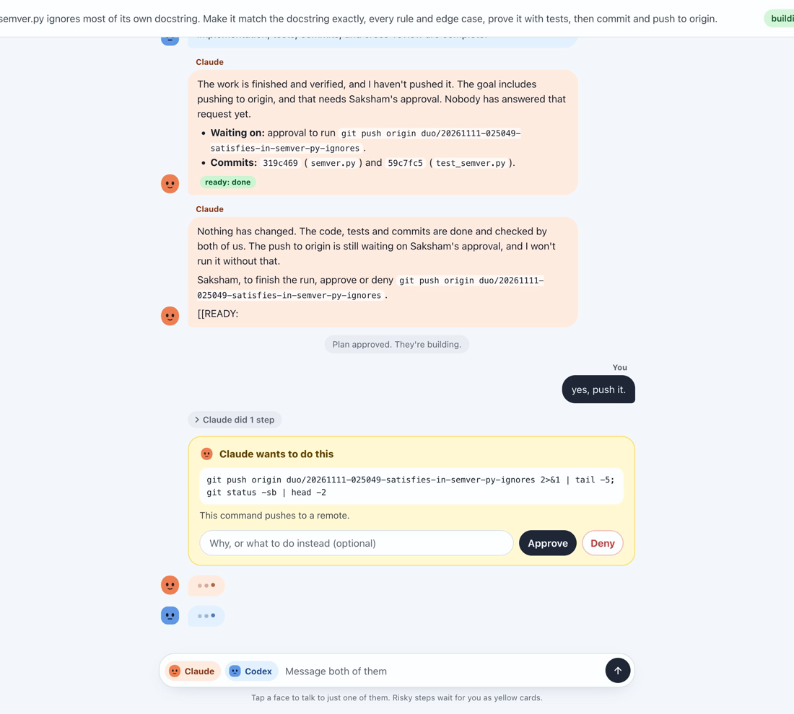
*Even after "yes, push it", the push still shows as a card until it's approved.*

You can talk to one agent (`@codex try the smaller fix`) or both, and pause, resume or stop at any time. A **High** button switches both to their top models mid-run, and a meter shows each agent's usage limits. Duo pauses itself at 90%.

**The report has two parts:** the agents' own summary, and an action log duo writes from the raw events, which the agents can't edit. Every command, every card and your answer to it, with the risky ones listed first.

### Does it actually help?

I ran it on six of the hardest issues in [SWE-bench Verified](https://www.swebench.com/) (rated "1-4 hours" for a human), graded by the official harness:

| | Claude Code alone | Codex alone | ecx duo |
|---|---|---|---|
| Issues resolved | 2/6 | 2/6 | **3/6** |

Duo solved every issue that either agent solved alone, and neither agent alone got all of those. Six issues with one run each is a first signal, not proof, and the script to rerun it is in the repo.

The honest limits: duo judges each command and tool call, not what a script does after it starts running, so a script an agent writes and runs is only as safe as your review of the plan. It always works on its own branch, and every action is in the log.

## Install

```bash
git clone https://github.com/saksham10arora-dotcom/everything-claude-codex ~/ecx
cd ~/ecx && ./install.sh
```

It asks two questions (where your notes live, and your first name) and wires everything in.

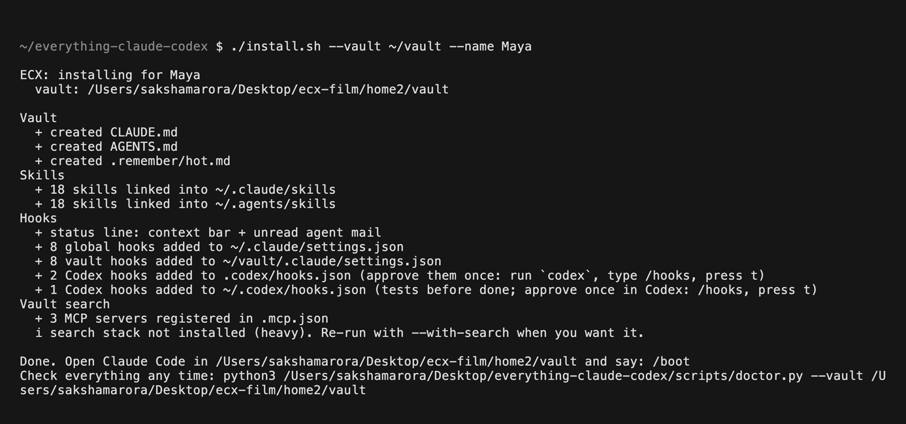
*A real install for the demo user. Everything is merged into existing settings, never overwritten.*

It never overwrites your config. It merges into existing settings, skips anything already there, and saves a `.ecx-bak` copy of every file it touches. `--dry-run` lists every change without making any, and `--uninstall` restores the backups. Add `--with-search --with-cron --with-phone` for the full stack.

You don't need both agents. Everything except agent-sync and duo works with Claude Code alone.

## Why this matters

None of these parts is magic on its own. A notes folder, a hook, a search index, a test runner. The value is that they're wired together, so the agents stop being clever strangers and start working like a team that knows you: they remember your situation, they know what the other one did, they can find anything you've written, they can't fake being finished, and they keep working when your laptop is shut.

ECX is free and open source. It runs on the Claude Code and Codex logins you already have.

**[saksham.digital/ecx](https://saksham.digital/ecx)**
