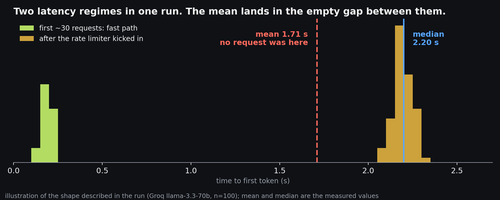
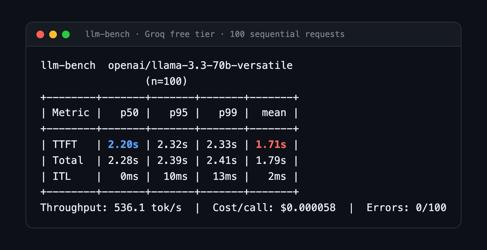
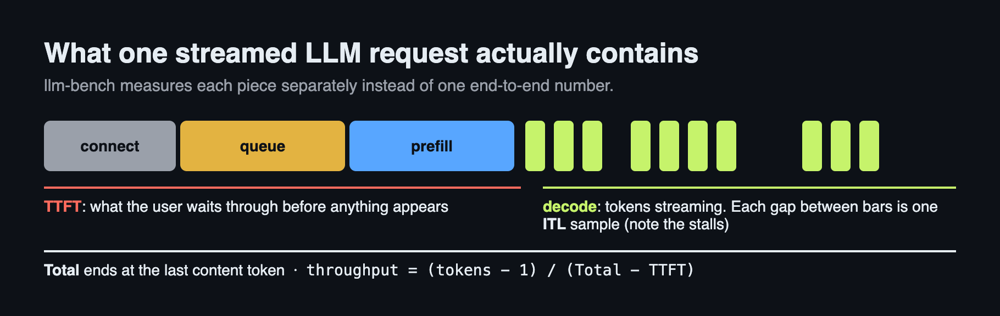
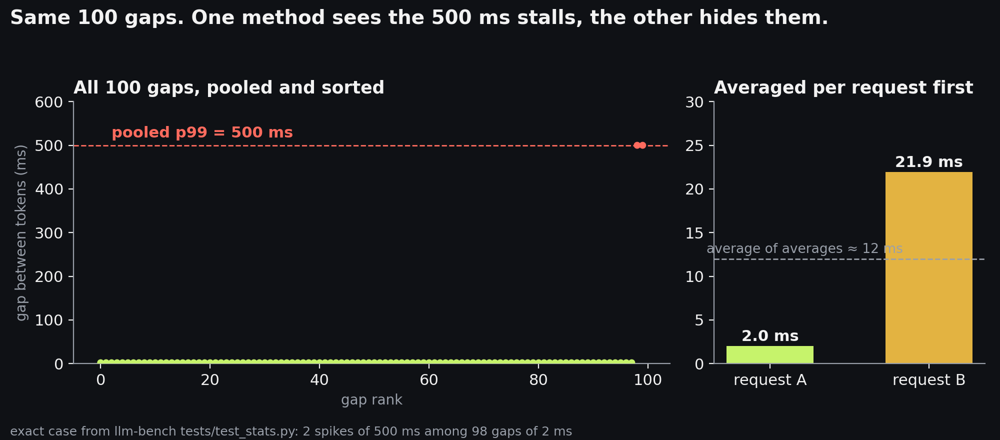
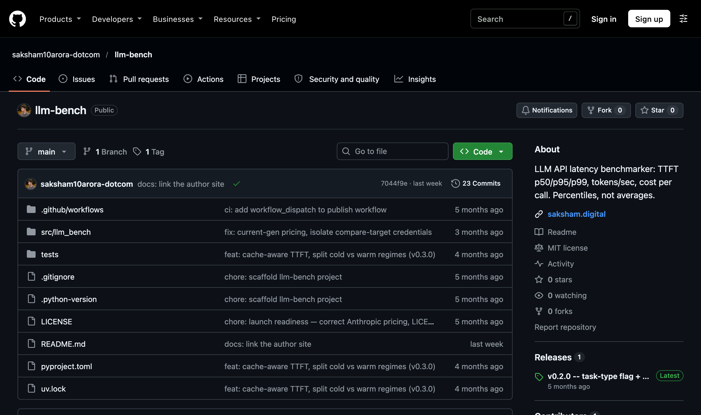
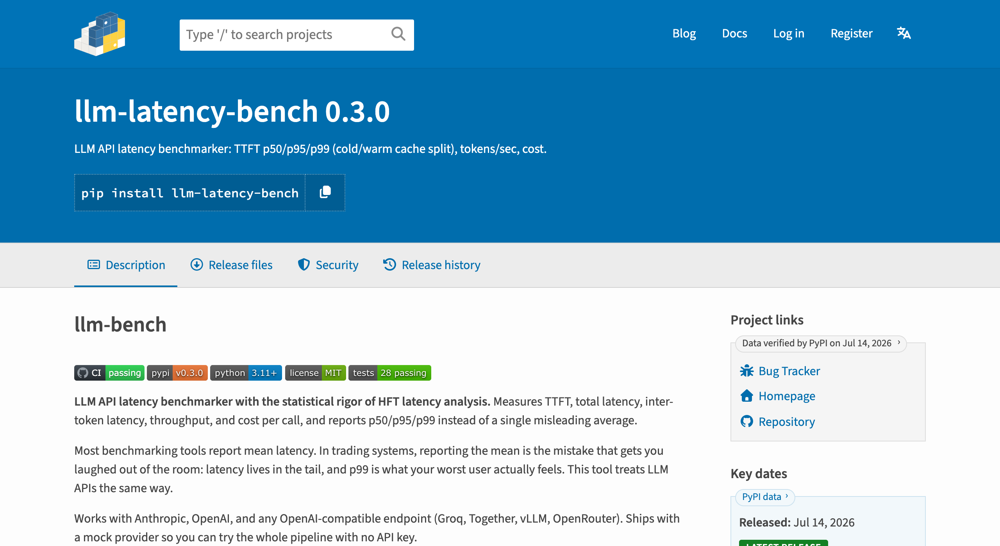

> I benchmarked an LLM API 100 times. The mean said 1.7 seconds. The median said 2.2 seconds. If that ordering looks impossible to you, good. That instinct is the whole point of this post.


*The whole post in one picture. The mean describes a request that never happened.*

---

## The number everyone reports is the wrong one

Search for any LLM latency comparison and you will find the same chart: average response time per provider. One bar for OpenAI, one for Anthropic, one for Groq. Clean, comparable, useless.

Here is why. Latency is not a number, it is a distribution. And LLM API latency distributions are ugly: long tails, queueing cliffs, cold starts, rate limit walls. The mean compresses all of that structure into one value that frequently describes no request that actually happened.

In trading systems this lesson is beaten into you early. Nobody at any serious shop reports mean latency. You report p50, p95, p99, p99.9. The p99 is what your worst user feels, and in production the worst user is the one who files the ticket.

LLM APIs deserve the same treatment. So I built a tool that does it: [llm-bench](https://github.com/saksham10arora-dotcom/llm-bench).

---

## The run that proved the point

The first real benchmark I ran with the finished tool was 100 requests to Groq's free tier, llama-3.3-70b-versatile, sequential, after warmup:


*The real output. The mean (red) is half a second below the median (blue).*

Look at the TTFT row. The mean is 1.71s. The median is 2.20s. The mean is below the median by half a second.

For a right-skewed latency distribution (the normal case), the mean sits above the median because the tail drags it up. Here the opposite happened, which means the distribution is not skewed, it is bimodal:

- The first ~30 requests returned in roughly 200ms. Fast path, no queueing.
- Then the free tier's rate limiter woke up. Every request after that waited about 2.2 seconds.

Two completely different latency regimes inside one run. The mean averaged them into 1.7s, a number that describes neither regime. No single request experienced 1.7s. The median, sitting in the throttled majority, told the truth about what most requests actually felt.

A mean-only benchmark would have printed "1.7s" and moved on. You would have shipped a latency budget based on a number that does not exist.

---

## What llm-bench measures, and why

Every measurement decision in the tool is documented in the README, because a benchmark you cannot interrogate is just a vibe with a table. First, what one request actually looks like:


*Every metric below is a different slice of this one timeline.*

The short version:

**TTFT, separately from total latency.** Time to first token is what a user perceives as "the app is responding." It deliberately includes connection setup, queueing, and prefill, because the user waits through all of it. Total latency ends at the last content chunk, not at trailing usage frames or connection teardown.

**Real percentiles, nearest-rank.** No interpolation, no smoothing. With n=100, p99 is your second-worst request, an actual observation, not an invented value between two observations. The tool warns you below n=100 because p99 of 5 samples is just the max wearing a costume.

**Inter-token latency from pooled raw gaps.** Every gap between consecutive chunks is timestamped and pooled across all requests, then percentiles are computed on the raw gaps. The tempting shortcut is to average gaps per request first. That shortcut destroys exactly the signal you want: one 500ms stall inside an otherwise smooth stream disappears into that request's average. Pooling keeps it visible at p99.


*This is the exact case from the test suite. The 500 ms stalls are real, but averaging per request reports about 12 ms.*

**Throughput as decode rate.** Tokens per second is computed as (completion_tokens - 1) / (total - TTFT). Including TTFT in the denominator blends queueing and prefill into a number that claims to be generation speed. Groq's 536 tok/s above is decode rate, the speed at which tokens actually streamed once they started.

**Errors never touch the percentiles.** A timed-out request has no valid latency. It gets counted and reported (errors: 0/100) but never averaged in, because a 30s timeout "latency" would poison every statistic above p90.

**Warmup is a strict phase.** Warmup requests fully complete before measurement begins, even under concurrency, so connection establishment and server-side cache effects never leak into the measured distribution.

None of this is novel. It is standard practice from systems performance work, applied to a domain where, for some reason, it is not yet standard.

---

## The part where I tell you it found a bug in itself

While reviewing the tool before release I found that my own first implementation committed several of the sins it was built to catch. The ITL "p99" was computed from per-request averages. Throughput included TTFT. The timeout flag was accepted and silently ignored. Warmup requests ran concurrently with measured ones under high concurrency.

Each of these produces plausible-looking numbers. That is what makes measurement bugs worse than crashes: a crash announces itself, a subtly wrong percentile gets quoted in a blog post.

The fix for all of them was the same discipline: write down what the metric is supposed to mean, then check the code computes exactly that and nothing else. The test suite now includes a case where 2 spike gaps hide among 98 fast ones, and asserts that pooled p99 surfaces 500ms while per-request averaging would have reported 12ms.

---

## Try it

```bash
# no API key needed, mock provider runs the full pipeline
uvx --from git+https://github.com/saksham10arora-dotcom/llm-bench llm-bench \
  --provider mock --model demo --prompt "hi" -n 20

# real benchmark against any OpenAI-compatible endpoint
llm-bench --provider openai --model llama-3.3-70b-versatile \
  --base-url https://api.groq.com/openai/v1 \
  --prompt "Explain recursion" -n 100

# compare two providers side by side
llm-bench --provider anthropic --model claude-sonnet-4-6 \
  --prompt "Explain recursion" -n 100 --compare openai:gpt-4o
```

Repo: [github.com/saksham10arora-dotcom/llm-bench](https://github.com/saksham10arora-dotcom/llm-bench)


*MIT licensed, with a mock provider so you can run the full pipeline without an API key.*

If you disagree with any measurement decision, the Methodology section of the README is the place to start the argument. That is what it is there for.

---

**Update (v0.2.0):** llm-bench is now on PyPI. `pip install llm-latency-bench`. Also ships a `--task` flag (`text`, `code`, `pdf`, `image`, `chat`) after feedback from a Sr DS at Meta that task type is upstream of any latency number: the metric profile that matters for batch PDF processing at night is completely different from interactive code gen. The flag adds that context to every benchmark output.


*Now on PyPI as `llm-latency-bench`.*
